# EventLogix: Hyper-Local Event and Fleet Logistics Marketplace

A full-stack marketplace where local event planners book, pay for and coordinate private event services (food trucks, AV setup crews, security teams, decor). The platform prevents double-booking, takes payment through PayPal, holds the vendor's share until the event is done, and then releases it through a payout ledger.

Built with **React, Django REST Framework and MySQL**. Phase 2 (planned) adds **RAG and LangChain agents** on top of the existing service layer.

> Payments run in **PayPal sandbox mode** (fake money). See [Known limitations](#known-limitations).

---

## Table of contents

1. [Features](#features)
2. [Tech stack](#tech-stack)
3. [How the project works](#how-the-project-works)
4. [Booking rules and business logic](#booking-rules-and-business-logic)
5. [Project structure](#project-structure)
6. [API reference](#api-reference)
7. [Getting started](#getting-started)
8. [PayPal sandbox and webhook setup](#paypal-sandbox-and-webhook-setup)
9. [Testing](#testing)
10. [Design decisions](#design-decisions)
11. [Known limitations](#known-limitations)
12. [Roadmap: Phase 2 (agentic AI)](#roadmap-phase-2-agentic-ai)

---

## Features

**For clients (event planners)**
- Browse verified vendors, filter by city and category
- See a live availability calendar for each vendor and service
- Reserve a slot, with a 15-minute hold and a live countdown
- Pay through PayPal checkout
- Cancel with a refund preview before confirming
- Report a problem during the dispute window after an event

**For vendors**
- Create a business profile and manage services (price in rupees, duration, hide or show)
- Confirm or decline paid bookings, cancel, and mark events completed
- Earnings dashboard: paid out, pending release, in dispute, upcoming

**Platform and safety**
- Double-booking protection using database row locks, proven by a concurrency test
- Booking state machine with one table of legal transitions
- Idempotent payments: browser, webhook and reconciliation job all share one function
- Late or unusable payments are refunded automatically, and retried until they succeed
- Held vendor payouts with a dispute window, retries and a provider interface
- Role-based access (client, vendor, admin) enforced on the server

---

## Tech stack

| Layer | Technology |
|---|---|
| Frontend | React (Vite), React Router, Axios, `@paypal/react-paypal-js` |
| Backend | Django, Django REST Framework, SimpleJWT, django-cors-headers |
| Database | MySQL (row locking with `SELECT ... FOR UPDATE`) |
| Payments | PayPal Orders v2 REST API (sandbox), PayPal webhooks |
| Config | python-decouple (`.env` files) |
| Dev tools | ngrok (to receive webhooks locally), Postman, Git |

---

## How the project works

### 1. System architecture

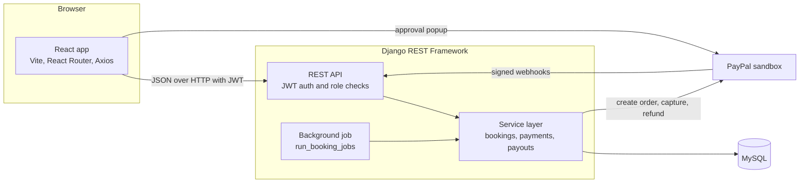

Views stay thin. All business rules live in a **service layer** (`bookings/services.py`, `bookings/lifecycle.py`, `payments/services.py`, `payments/payouts.py`), which is also what the Phase 2 agents will call as tools.

### 2. End-to-end flow

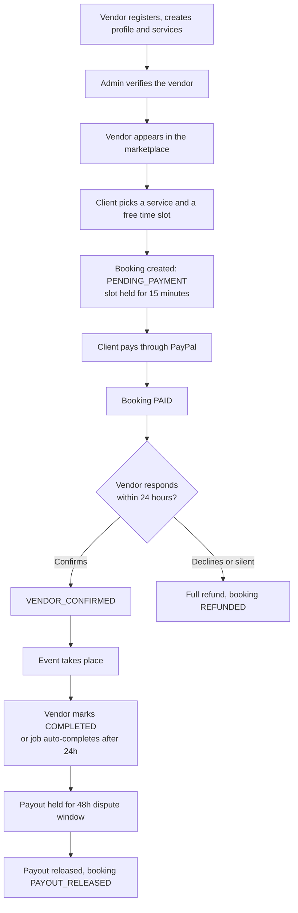

### 3. Booking and payment sequence

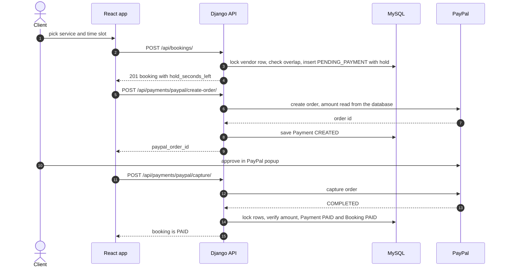

The frontend never sends an amount. The server reads the price from its own database, creates the PayPal order, and verifies the captured amount before marking anything as paid.

### 4. Double-booking protection

Two clients clicking "Book" on the same slot at the same moment must not both succeed. The booking service locks the **vendor row** first, so concurrent requests for that vendor run one at a time.

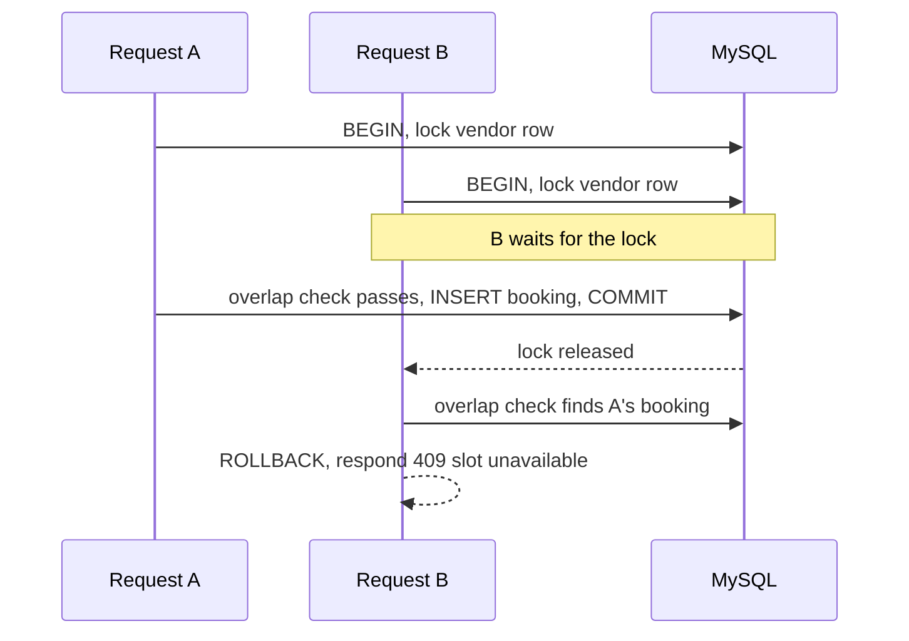

Two ranges overlap when `new_start < existing_end AND new_end > existing_start`, so back-to-back bookings are allowed. `bookings/tests.py` contains a multi-threaded test that fires several simultaneous bookings at one slot and asserts exactly one wins.

### 5. Booking state machine

All status changes go through one function, `change_status()`, which checks a table of allowed transitions. Anything not in the table is rejected.

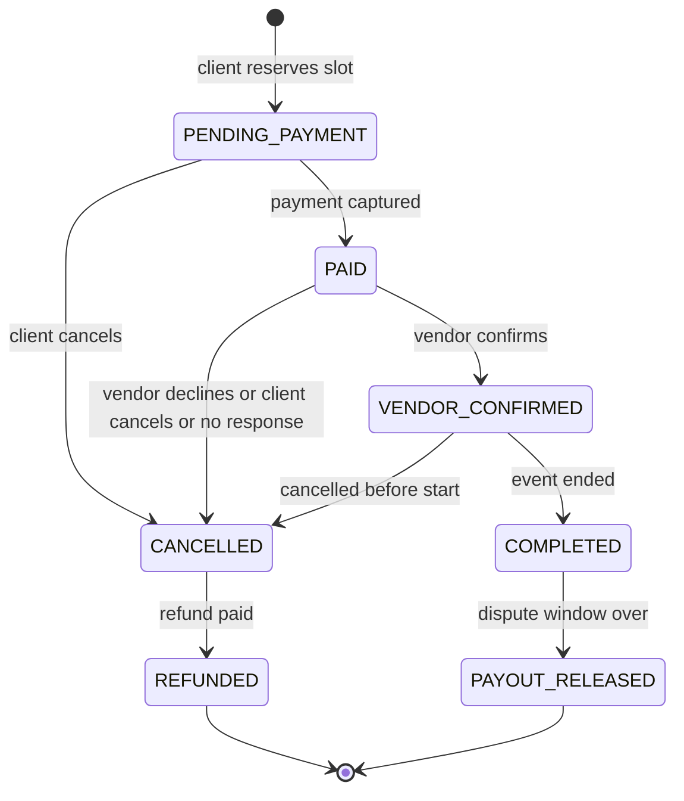

An unpaid booking whose hold runs out simply stops blocking the vendor's calendar. If someone pays after that, the payment logic below decides what happens.

### 6. Payment safety net: webhooks, reconciliation and refunds

The browser, PayPal webhooks and a reconciliation job can all report the same payment, in any order, more than once. Every path ends in one function, `finalize_capture()`, which uses row locks and a status check so a booking becomes paid **exactly once**.

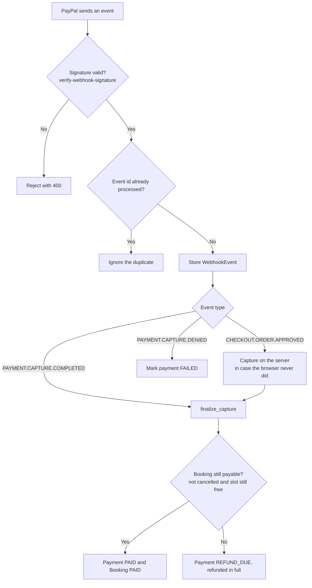

| Guarantee | Mechanism |
|---|---|
| No duplicate PayPal orders | `PayPal-Request-Id` header plus unique `(provider, order_id)` and `get_or_create` |
| A failed attempt can be retried | Request ID includes an attempt number |
| Webhooks processed once | Unique `WebhookEvent.event_id` |
| Closed browser after approval | `CHECKOUT.ORDER.APPROVED` handler captures server-side |
| Lost webhook | Reconciliation job asks PayPal for the order status |
| Payment after the slot was lost | Detected inside the same locked transaction, refunded automatically |
| Refund fails (gateway down) | Payment stays `REFUND_DUE`, and the job retries |

### 7. Held payouts

The vendor's share (total minus the platform fee) is not paid at booking time. It is recorded in a `Payout` ledger and released after the event and a dispute window.

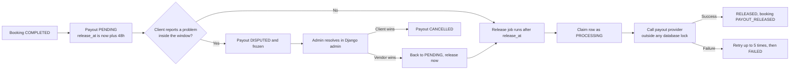

The actual transfer sits behind a provider interface (`payments/payout_providers.py`). A **mock provider** is used today, so a real provider (for example Razorpay Route or a bank payout API) plugs in by implementing one `send()` method. The ledger, timing, retries and disputes are real.

### 8. Database model

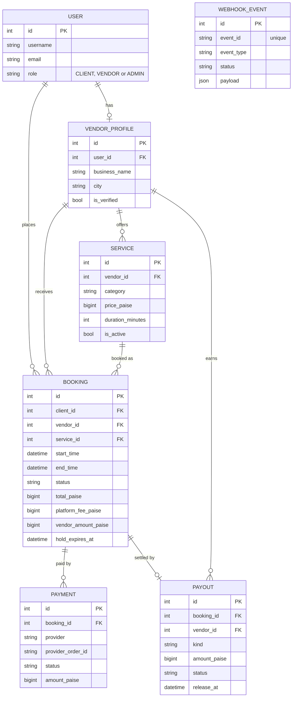

All money is stored as **integer paise**, never floats.

---

## Booking rules and business logic

All values are settings in `config/settings.py`, not hard-coded.

| Rule | Value |
|---|---|
| Platform fee | 10% of the booking total |
| Slot hold while paying | 15 minutes (`BOOKING_HOLD_MINUTES`) |
| Vendor must respond to a paid booking | 24 hours, otherwise auto-decline with full refund |
| Auto-complete after the event ends | 24 hours |
| Payout dispute window | 48 hours after completion |
| Payout retries | 5 attempts, then `FAILED` for admin attention |

**Cancellation and refunds**

| Who cancels | When | Refund |
|---|---|---|
| Client | Before paying | Nothing to refund |
| Client | Paid, vendor has not confirmed yet | 100% |
| Client | Confirmed, 7 or more days before start | 100% |
| Client | Confirmed, 2 to 7 days before start | 50% |
| Client | Confirmed, under 2 days before start | 0% |
| Vendor, system or admin | Any time before start | 100% |

Nobody can cancel once the event has started. When a client cancels late and the platform keeps money, the vendor is compensated for the held slot through a `CANCELLATION` payout (minus the platform fee).

**Roles**

| Role | Can do |
|---|---|
| Client | Book, pay, cancel, dispute, view own bookings |
| Vendor | Manage own profile and services, confirm, decline, cancel, complete, view own bookings and earnings |
| Admin (Django admin) | Verify vendors, resolve disputes, reprocess webhook events, retry failed payouts |

Nobody can self-register as admin. Other users' bookings return **404**, so their existence is not revealed.

---

## Project structure

```
event-sync-logistics/
├── README.md
├── .gitignore
├── backend/
│   ├── manage.py
│   ├── requirements.txt
│   ├── .env.example
│   ├── config/                  settings and root URLs
│   ├── accounts/                custom User with roles, register, login, refresh, me
│   ├── vendors/                 vendor profile, services, public marketplace listing
│   ├── bookings/
│   │   ├── models.py            Booking and statuses
│   │   ├── services.py          overlap check, create_booking, state machine
│   │   ├── lifecycle.py         confirm, decline, complete, cancel, refund rules
│   │   ├── views.py
│   │   └── management/commands/run_booking_jobs.py
│   └── payments/
│       ├── models.py            Payment, Payout, WebhookEvent
│       ├── paypal_service.py    PayPal REST calls and webhook verification
│       ├── services.py          create order, capture, finalize, reconcile, refunds
│       ├── webhooks.py          event handlers with idempotent processing
│       ├── payouts.py           payout ledger, release, disputes
│       └── payout_providers.py  provider interface (mock today)
└── frontend/
    ├── package.json
    ├── .env.example
    └── src/
        ├── api/client.js        Axios with JWT and automatic token refresh
        ├── auth/                AuthContext and ProtectedRoute
        ├── components/          AvailabilityCalendar, BookingCard, BookingBoard, forms
        ├── hooks/               useCountdown
        ├── pages/               Marketplace, VendorDetail, Book, Pay, Dashboard,
        │                        VendorBusiness, Login, Register
        └── utils/               time, format, status helpers
```

---

## API reference

Base URL: `http://127.0.0.1:8000/api`. Protected endpoints need `Authorization: Bearer <access token>`.

**Auth** (`/auth/`)

| Method | Endpoint | Description |
|---|---|---|
| POST | `/auth/register/` | Register as `CLIENT` or `VENDOR` |
| POST | `/auth/login/` | Get access and refresh tokens |
| POST | `/auth/refresh/` | Refresh the access token |
| GET | `/auth/me/` | Current user |

**Vendors** (`/vendors/`)

| Method | Endpoint | Who | Description |
|---|---|---|---|
| GET | `/vendors/?city=&category=` | Public | Verified vendors, filtered |
| GET | `/vendors/<id>/` | Public | Vendor detail with services |
| GET, POST, PATCH | `/vendors/me/profile/` | Vendor | Own business profile |
| GET, POST | `/vendors/me/services/` | Vendor | List and create own services |
| PATCH, DELETE | `/vendors/me/services/<id>/` | Vendor | Edit, hide or delete (delete is blocked if bookings exist) |

**Bookings** (`/bookings/`)

| Method | Endpoint | Who | Description |
|---|---|---|---|
| GET, POST | `/bookings/` | Authenticated | List own bookings (`?status=`) or create one (clients only) |
| GET | `/bookings/<id>/` | Client or vendor of the booking | One booking |
| GET | `/bookings/vendors/<vendor_id>/busy/?date=YYYY-MM-DD` | Public | Busy windows for the calendar |
| GET | `/bookings/<id>/cancel-preview/` | Client or vendor | Refund if cancelled now |
| POST | `/bookings/<id>/confirm/` | Vendor | Confirm a paid booking |
| POST | `/bookings/<id>/decline/` | Vendor | Decline with full refund |
| POST | `/bookings/<id>/complete/` | Vendor | Mark completed after the event |
| POST | `/bookings/<id>/cancel/` | Client or vendor | Cancel with the refund rules above |

**Payments** (`/payments/`)

| Method | Endpoint | Who | Description |
|---|---|---|---|
| POST | `/payments/paypal/create-order/` | Client | Create a PayPal order for a booking |
| POST | `/payments/paypal/capture/` | Client | Capture and verify the payment |
| POST | `/payments/paypal/webhook/` | PayPal | Signed webhook receiver |
| GET | `/payments/payouts/` | Vendor | Payout history |
| GET | `/payments/earnings/` | Vendor | Earnings summary |
| POST | `/payments/bookings/<id>/dispute/` | Client | Report a problem during the dispute window |

Error conventions: `400` validation, `401` not logged in, `403` wrong role, `404` not found or not yours, `409` conflict (slot taken or illegal status change), `502` payment provider error.

---

## Getting started

### Prerequisites
- Python 3.11 or newer
- Node.js (LTS)
- MySQL 8
- A PayPal developer account (free)

### 1. Clone

```bash
git clone https://github.com/Abhiii1110/event-sync-logistics.git
cd event-sync-logistics
```

### 2. Backend

```bash
cd backend
py -m venv venv                  # macOS/Linux: python3 -m venv venv
venv\Scripts\activate            # macOS/Linux: source venv/bin/activate
pip install -r requirements.txt
```

If `mysqlclient` fails to install on Windows, run `pip install pymysql` and add these two lines at the top of `config/__init__.py`:

```python
import pymysql
pymysql.install_as_MySQLdb()
```

Create the database (MySQL Workbench or the `mysql` shell):

```sql
CREATE DATABASE eventlogix CHARACTER SET utf8mb4 COLLATE utf8mb4_unicode_ci;
```

Copy `.env.example` to `.env` and fill it in:

```
SECRET_KEY=change-me-to-a-long-random-string
DEBUG=True
ALLOWED_HOSTS=127.0.0.1,localhost
DB_NAME=eventlogix
DB_USER=root
DB_PASSWORD=your_mysql_password
DB_HOST=127.0.0.1
DB_PORT=3306
PAYPAL_CLIENT_ID=your-sandbox-client-id
PAYPAL_CLIENT_SECRET=your-sandbox-secret
PAYPAL_BASE_URL=https://api-m.sandbox.paypal.com
PAYPAL_WEBHOOK_ID=
PAYPAL_WEBHOOK_VERIFY=True
```

Then:

```bash
py manage.py migrate
py manage.py createsuperuser
py manage.py runserver
```

### 3. Frontend

```bash
cd frontend
npm install
```

Copy `.env.example` to `.env`:

```
VITE_API_URL=http://127.0.0.1:8000
VITE_PAYPAL_CLIENT_ID=your-sandbox-client-id
VITE_PAYPAL_CURRENCY=USD
```

```bash
npm run dev
```

Open http://localhost:5173. Never put the PayPal **secret** in a `VITE_` variable. Only the public Client ID belongs in the frontend.

### 4. Background job

Time-based work (auto-decline, auto-complete, refund retries, payout release, payment reconciliation) runs from one command:

```bash
py manage.py run_booking_jobs
```

It is safe to run repeatedly. In production, schedule it every few minutes with cron, Windows Task Scheduler or Celery beat.

### 5. Try the whole flow

1. Register a **vendor**, open **My business**, create a profile, and add a service.
2. In Django admin (`/admin`), open the vendor profile and tick **Is verified**.
3. Register a **client** in another browser (or an incognito window, because tokens are stored per browser).
4. As the client, open the vendor, pick a green slot, enter a location, and pay with the PayPal sandbox buyer account.
5. As the vendor, open the dashboard and **Confirm** the booking.
6. In admin, move the booking's start and end times into the past, then **Mark completed** as the vendor.
7. Run `py manage.py run_booking_jobs` after the payout's `release_at` has passed, and watch the payout release.

---

## PayPal sandbox and webhook setup

1. Log in at **developer.paypal.com** and switch to **Sandbox**.
2. Under **Testing Tools → Sandbox Accounts**, create a **Business** and a **Personal** account (use **United States** for both).
3. Under **Apps & Credentials**, create a **Merchant** app using the Business account. Copy the Client ID and Secret into the `.env` files.
4. To test webhooks locally, start a tunnel with `ngrok http 8000`, add the ngrok host to `ALLOWED_HOSTS`, and in the app's **Webhooks** section click **Add Webhook** with this URL:
   ```
   https://<your-ngrok-host>/api/payments/paypal/webhook/
   ```
   Subscribe to **Checkout order approved**, **Payment capture completed** and **Payment capture denied**.
5. Copy the **Webhook ID** into `PAYPAL_WEBHOOK_ID` and restart Django.
6. Pay using the **Personal** sandbox account in the popup.

For quick local experiments without a tunnel, set `DEBUG=True` and `PAYPAL_WEBHOOK_VERIFY=False`, then post a hand-written event to the webhook URL. The bypass has no effect when `DEBUG` is `False`.

---

## Testing

```bash
py manage.py test
```

The suite covers:
- Overlap rules (same time, partial overlap, back-to-back) and a **multi-threaded double-booking test** (needs MySQL, because SQLite ignores row locks)
- The full booking lifecycle: confirm, decline, cancel with each refund tier, completion rules, gateway outage handling
- Payment flows with mocked PayPal: idempotent capture, amount mismatch, other users' orders
- Webhooks: duplicates, forged signatures, approval without browser capture, payment after the slot was lost, failed refund retried later, reconciliation
- Payouts: dispute window, retries, stuck jobs, disputes, cancellation compensation
- Vendor management API: profile and service rules

Some tests print tracebacks such as "gateway down" on purpose, because they simulate failures.

---

## Design decisions

| Decision | Reason |
|---|---|
| Business logic in a service layer, not in views | Easy to test, and the Phase 2 agents can call the same functions as tools |
| Money as integer paise | No floating-point errors |
| Lock the vendor row, not the bookings | When no bookings exist yet there are no rows to lock |
| Server-side amounts and signature verification | The browser is never trusted with money |
| Single `finalize_capture()` for every payment path | Exactly-once effect, whoever reports the payment first |
| Refund after commit, retried by a job | A gateway outage can never lose a cancellation |
| Payout provider interface | Swap the mock for a real provider without touching business logic |
| "Held payout", not "escrow" | Accurate wording: true escrow has legal and regulatory meaning |
| Server-calculated hold timer (`hold_seconds_left`) | A wrong clock on the user's device cannot extend or shorten the hold |

---

## Known limitations

- **PayPal works in sandbox only.** PayPal does not support domestic payments within India, so a real launch for Indian customers would use an Indian gateway (for example Razorpay). The `Payment` table already has a `provider` field to allow a second gateway.
- **Sandbox currency demo:** the rupee price is sent to PayPal as dollars (paise divided by 100) with no real conversion.
- **Payouts use a mock provider.** Real transfers need vendor KYC and bank or linked-account details.
- **Refund webhooks** (`PAYMENT.CAPTURE.REFUNDED`) are not handled, so a refund issued from PayPal's own dashboard will not update the booking.
- **Dispute resolution** happens in Django admin, not in the UI.
- **The background job** must be scheduled externally in production.
- **Vendor verification** is a manual admin action.

---

## Roadmap: Phase 2 (agentic AI)

Phase 1 was built so that agents can use the existing service layer directly.

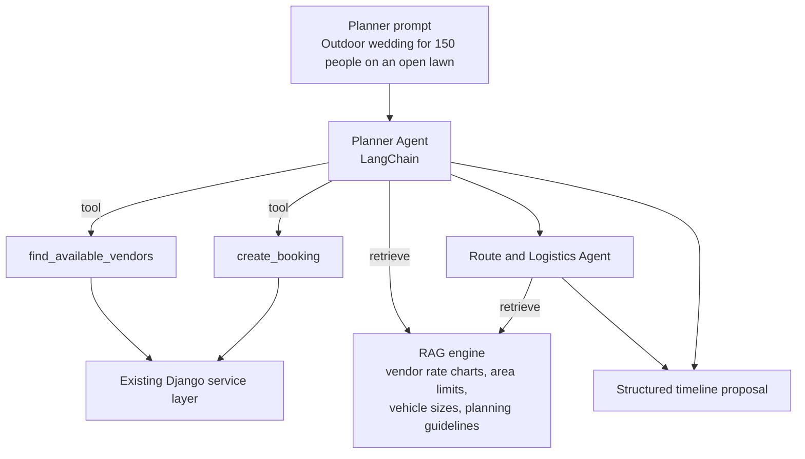

Planned work:
- [ ] RAG engine: embed vendor rate charts, regional boundary rules, vehicle dimensions and event planning guidelines in a vector store
- [ ] Planner Agent: turn a free-text event description into a structured proposal by querying real vendor availability
- [ ] Route and Logistics Agent: order vendor arrival times (for example, the setup crew before catering trucks)
- [ ] Razorpay as a second payment provider
- [ ] Real payout provider and vendor onboarding with KYC
- [ ] Refund webhooks and an admin dispute UI
- [ ] Deployment (backend, MySQL, frontend) and scheduled jobs

---

## Screenshots

Add screenshots to `docs/screenshots/` and uncomment the lines below.


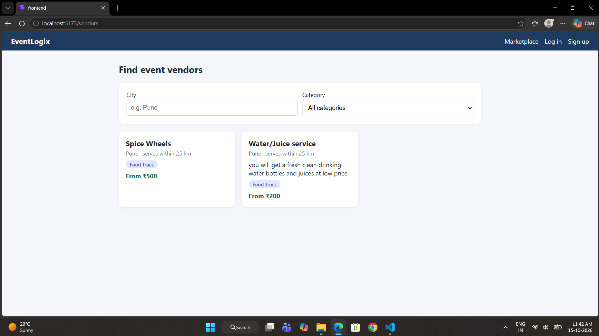
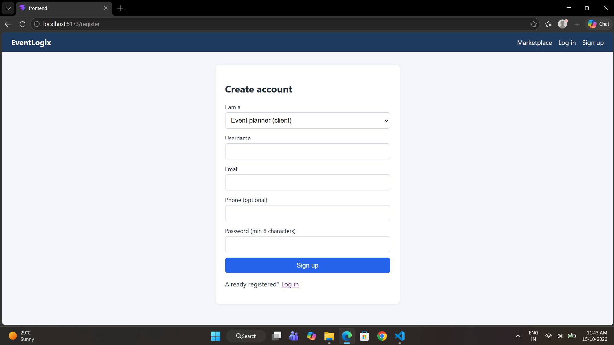
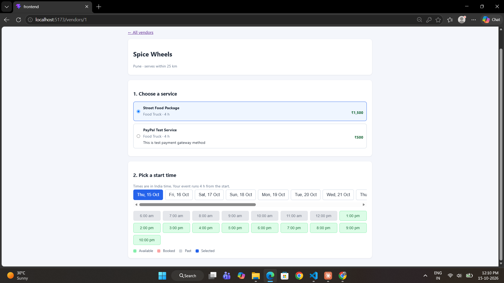


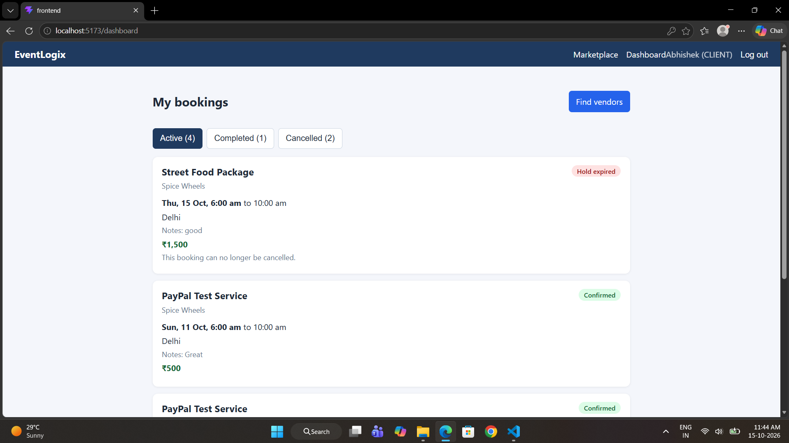
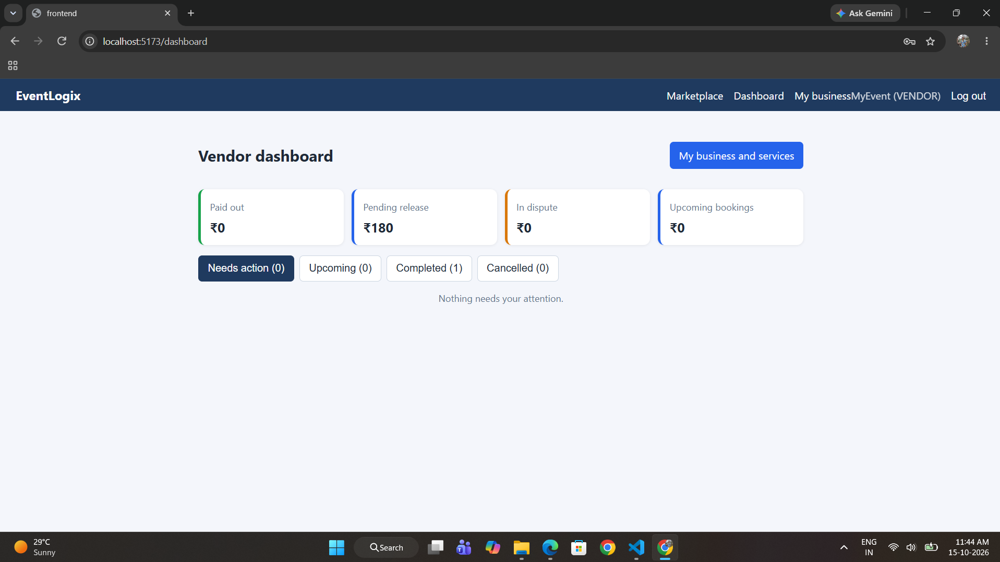


---

Built by [@Abhiii1110](https://github.com/Abhiii1110).
